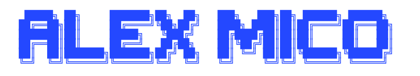
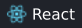
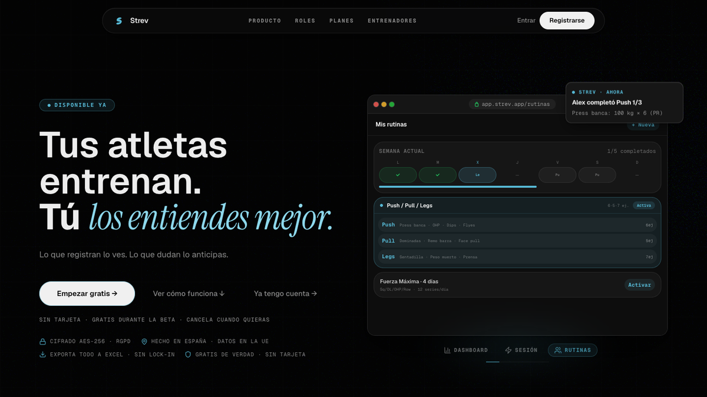
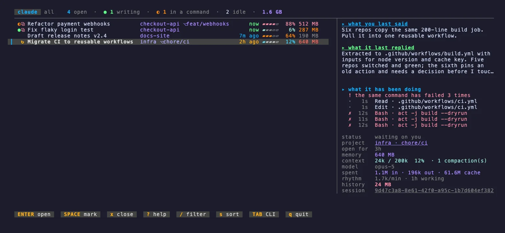
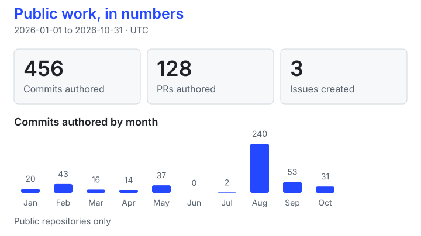

<picture>
  <source media="(prefers-color-scheme: dark)" srcset="./assets/profile/terminal-dark.svg">
  
</picture>

**`Full stack · Products · Developer tools`**

[Portfolio](https://portfolioalex-mico.vercel.app/) · [CV](https://portfolioalex-mico.vercel.app/Alex_Mico_Robles_CV_EN.pdf) · [Email](mailto:alexmico2006@gmail.com)

##  About Me

> I'm Alex Micó Robles, a full stack developer in Alicante, Spain. I build web products and tools for my own workflow.

 <strong>Web products</strong> 
React interfaces and Node.js APIs.

 <strong>Developer tools</strong> 
Python tools for coding-agent sessions, job searches and local automation.

 <strong>Applied AI</strong> 
Exercise video analysis with Gemini in Strev.

 <strong>Security experiments</strong> 
Deterministic checks for agent controls in RoguePatch Lab.

Currently building [Strev](https://strev.app) and [Sereno](https://github.com/ElRaxy/sereno), alongside local automation tools.

##  Tech stack

**Frontend**

**Backend & data**

**Tools & automation**

**Testing & delivery**

**AI in Strev**

##  Featured projects

### [Strev](https://strev.app)

Routines, progress, payments and video technique review for personal trainers. React + Node.js. Closed source.

### [Sereno](https://github.com/ElRaxy/sereno)

A Python terminal UI for coding-agent sessions. See what is running, waiting or stopped. Data stays local.

### [RoguePatch Lab](https://github.com/ElRaxy/roguepatch-lab)

An adversarial bench for external agent controls, with deterministic checks and typed evidence.

### [SaveMyMoneyNow](https://github.com/ElRaxy/SaveMyMoneyNow)

Bank statement imports with header detection, column mapping and duplicate checks. React + Express + MongoDB.

### [Atalaya](https://github.com/ElRaxy/atalaya-cli)

A Python CLI that collects, deduplicates and ranks developer roles. The person chooses where to apply.

Inside Strev and Sereno

#### Strev

[Case study](https://portfolioalex-mico.vercel.app/en/projects/strev/)

#### Sereno

[Case study](https://portfolioalex-mico.vercel.app/en/projects/sereno/) · [Latest release](https://github.com/ElRaxy/sereno/releases/latest)

##  Contribution Metrics

<picture>
  <source media="(prefers-color-scheme: dark) and (max-width: 1000px)" srcset="./assets/profile/metrics-dark-mobile.svg">
  <source media="(max-width: 1000px)" srcset="./assets/profile/metrics-light-mobile.svg">
  <source media="(prefers-color-scheme: dark)" srcset="./assets/profile/metrics-dark.svg">
  
</picture>

How these numbers are counted

Updated daily from the [GitHub Search API](./assets/profile/metrics-public.json), using public repositories only. Commits cover default branches. Pull requests and issues are counted by creation date, regardless of whether they are currently open or closed. These counts use a different definition from GitHub's contribution calendar.

More GitHub stats

<picture>
  <source media="(prefers-color-scheme: dark)" srcset="https://github-readme-stats.vercel.app/api?username=ElRaxy&amp;card_width=400&amp;disable_animations=true&amp;show_icons=true&amp;hide_border=true&amp;hide_rank=true&amp;hide=stars&amp;theme=dark&amp;bg_color=00000000&amp;title_color=879aff&amp;icon_color=879aff">
  
</picture>

 

<picture>
  <source media="(prefers-color-scheme: dark)" srcset="https://github-readme-stats.vercel.app/api/top-langs/?username=ElRaxy&amp;card_width=400&amp;disable_animations=true&amp;layout=compact&amp;hide_border=true&amp;langs_count=6&amp;theme=dark&amp;bg_color=00000000&amp;title_color=879aff">
  
</picture>

Language shares describe code in public repositories, not proficiency.

### Contribution graph

<picture>
  <source media="(prefers-color-scheme: dark)" srcset="https://raw.githubusercontent.com/ElRaxy/ElRaxy/output/github-snake-dark.svg">
  
</picture>

Generated daily from my GitHub contributions with <a href="https://github.com/Platane/snk">snk</a>.
