<picture>
  <source media="(prefers-color-scheme: dark) and (max-width: 600px)" srcset="./assets/profile/name-dark-mobile.svg">
  <source media="(max-width: 600px)" srcset="./assets/profile/name-light-mobile.svg">
  <source media="(prefers-color-scheme: dark)" srcset="./assets/profile/name-dark.svg">
  
</picture>

# Alex Micó Robles

I build web products and tools I use in my own workflow. That means React interfaces, Node.js APIs and, sometimes, a Python tool that fits in one file.

Alongside product work, I automate repetitive tasks and build local tools for working with coding agents.

[Portfolio](https://portfolioalex-mico.vercel.app/) · [CV](https://portfolioalex-mico.vercel.app/Alex_Mico_Robles_CV_EN.pdf) · [Email](mailto:alexmico2006@gmail.com)

## What I work with

  <strong>Interfaces</strong> 
  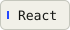
  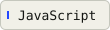
  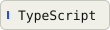

  <strong>APIs &amp; data</strong> 
  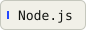
  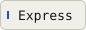
  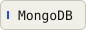

  <strong>Local tools &amp; automation</strong> 
  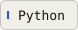
  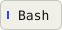

  <strong>Testing &amp; delivery</strong> 
  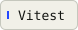
  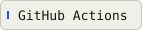

  <strong>Video analysis in Strev</strong> 
  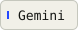
  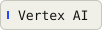

## Products & experiments

### [Strev](https://strev.app)

A web product for personal trainers to build routines, follow progress, handle payments and review exercise technique on video. I work across the React interface and Node.js API, including the background queue for video analysis.

[Visit Strev](https://strev.app) · [Case study](https://portfolioalex-mico.vercel.app/en/projects/strev/) · Closed source

### [Sereno](https://github.com/ElRaxy/sereno)

When I have several coding-agent sessions open, I want to know which ones need me. Sereno reads their local histories and shows what is running, waiting or stopped in one Python terminal UI. Session data stays on the machine.

[Source](https://github.com/ElRaxy/sereno) · [Latest release](https://github.com/ElRaxy/sereno/releases/latest) · [Case study](https://portfolioalex-mico.vercel.app/en/projects/sereno/)

| Project | What it does |
| :--- | :--- |
| [RoguePatch Lab](https://github.com/ElRaxy/roguepatch-lab) | Tests whether external coding-agent controls stop the actions they claim to stop. Deterministic checks and typed evidence. |
| [SaveMyMoneyNow](https://github.com/ElRaxy/SaveMyMoneyNow) | Imports bank statements with different layouts. Detects headers, maps columns and checks for duplicates before saving. |
| [Atalaya](https://github.com/ElRaxy/atalaya-cli) | Collects developer roles, removes duplicates and ranks them against a profile. The person chooses where to apply. |

Inside Strev and Sereno

#### Strev

#### Sereno

